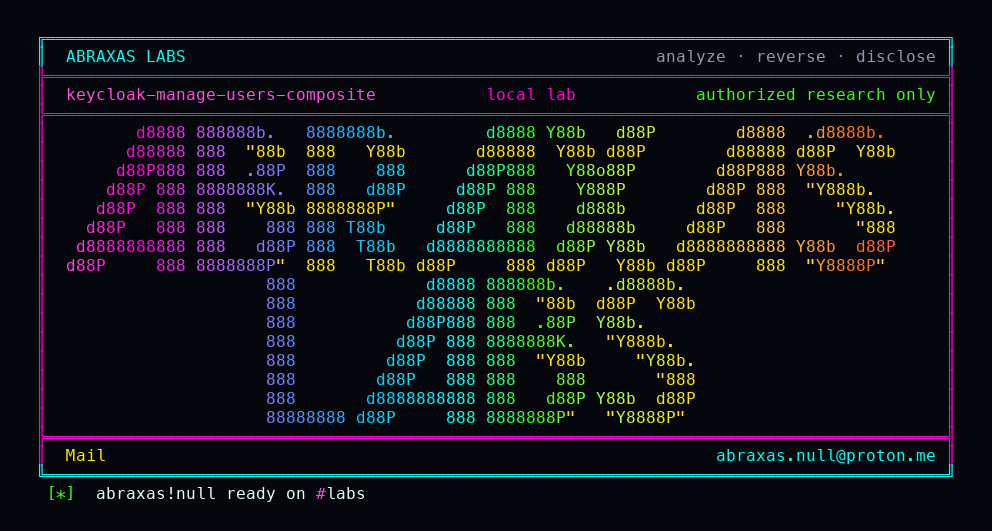

<p align="center">
  
</p>

# keycloak-manage-users-composite

A help-desk account that is only supposed to reset passwords and create users can promote itself. Someone with Keycloak's `manage-users` role finds a leftover job-title in the realm (a composite role that quietly includes `manage-realm`), pins that title on their own account, and then reads the full realm document that was hidden from them a request earlier. They cannot mint that composite. A real realm administrator has to have built it first. This is the role-mapping sibling of [CVE-2026-94000](https://www.cve.org/CVERecord?id=CVE-2026-94000), which closed the same trick on group join.

**Class:** Auth leftover
**Reach:** Remote (authenticated `manage-users`)

**Keycloak** `26.8.1` (`24ed1dad`) - Red Hat

| | |
|---|---|
| ID | no CVE yet |
| Class | **Auth leftover** |
| Reach | **Remote** (authenticated Admin REST; needs `manage-users` plus a pre-built composite) |
| CWE | [CWE-269](https://cwe.mitre.org/data/definitions/269.html) / [CWE-266](https://cwe.mitre.org/data/definitions/266.html) |
| CVSS | **Medium: 6.6** `CVSS:3.1/AV:N/AC:H/PR:H/UI:N/S:U/C:H/I:H/A:H` |
| Product | [Keycloak](https://github.com/keycloak/keycloak) |
| Affected | **26.8.1** (`24ed1dadf3f246a555adb6d3d4a99e9b3003fb3b`); image `quay.io/keycloak/keycloak:26.8.1` |
| Auth | delegated admin with `realm-management` / `manage-users`. FGAP v2 is the default evaluator. |
| License | [GNU Affero GPL v3.0](LICENSE) |
| Lab | `127.0.0.1:18082` only |

## What an attacker can do

Needs an existing Keycloak account that already holds `manage-users`, and a realm or client role whose own name is not an admin role and whose composites include `manage-realm` or `realm-admin`. Does not need `manage-realm` on the token. Cannot create that composite. Direct assignment of a role named `manage-realm` / `realm-admin` is still refused.

| Privilege | Method / sink | Recon / integrity / availability | Lab-proven or inferred |
|---|---|---|---|
| Map a non-admin composite onto self | `POST /admin/realms/{realm}/users/{id}/role-mappings/realm` with the composite id and name | Integrity (role grant) | Lab-proven. HTTP 204. Witness `kcr02m7q4` |
| Same grant on a client role | `POST /admin/realms/{realm}/users/{id}/role-mappings/clients/{client}` | Integrity | Source. Same `canMapRole` at `ClientRoleMappingsResource.java:184` |
| Read the full realm document on the same access token | `GET /admin/realms/{realm}` after the mapping | Recon | Lab-proven. Before: HTTP 200 partial (no attributes, no `accessTokenLifespan`). After: HTTP 200 full, planted attribute present |
| Use nested `manage-realm` on later admin calls | `UserAdapter.hasRole` walks composites; `KeycloakIdentity.hasClientRole` trusts the user model | Integrity | Inferred from source. Lab oracle is the full realm GET |
| Nested `realm-admin` when that is the composite | Same walk | Integrity | Inferred. Lab used `manage-realm` |
| Negative control | A second `manage-users` user who does not map the composite | n/a | Lab-proven. Control GET stays partial |

**Stays closed on this leftover**

| Axis | Method / sink | Why it is closed |
|---|---|---|
| Integrity | Direct map of `manage-realm` / `realm-admin` / other `AdminRoles.ALL_ROLES` | `RolePermissionsV2.isRealmAdminRole` still refuses |
| Integrity | Create the composite that includes an admin role | `canMapComposite` still calls `checkAdminRoles` |
| Integrity | Join a group whose composite includes an admin role | [CVE-2026-94000](https://www.cve.org/CVERecord?id=CVE-2026-94000) walks composites in `GroupUtils.checkAdminGroupRoles` |
| Integrity | Create a user already in that group | Same walk on `UsersResource.createUser` |
| Recon | Anonymous Admin REST | Needs a `manage-users` token |
| Integrity | Host RCE, realm-admin minting realm-admin | Out of class |

`GET /admin/realms/{realm}` is not HTTP 403 for `manage-users`. That role is itself an admin role, so the server returns 200 with a partial document. The leftover is the fields that appear only after the composite is mapped.

## How I found it

I pinned Keycloak **26.8.1**. Fine-grained admin permissions v2 is on by default. `RolePermissionsV2.canMapRole` returns true for every role that fails `isRealmAdminRole` and never walks composites. The CVE-2026-94000 fix walks them only on the group path.

Wrong turns already recorded: treating v1 `isRealmAdminRole` as the live check (v2 overrides it); expecting HTTP 403 on the realm GET before the grant (live result is a partial 200); re-filing CVE-2026-94000 (group join, already closed); a reverse shell. Theatre.

## Lab

```bash
python3 keycloak-manage-users-composite-Abraxas-Labs.py
```

or:

```bash
cd lab
./run.sh
```

Target **only** `http://127.0.0.1:18082`. Image `quay.io/keycloak/keycloak:26.8.1`. Docker required. The launcher `chdir`s into `lab/` and execs `run.sh`.

```text
IOC image=quay.io/keycloak/keycloak:26.8.1 label-version=26.8.1
IOC serverinfo-version=26.8.1
IOC admin-composite=manage-realm
IOC limited-direct=manage-users
IOC control-direct=manage-users
IOC before-status=200 witness=0 full=0
IOC available=sneaky-composite
IOC post-status=204
IOC after-get attempt=1 status=200 witness=1 full=1
IOC control-status=200 witness=0 full=0 same-token=1
SUCCESS KC-H02-ROLEMAP kcr02m7q4
```

## The fix

Walk composites in `RolePermissionsV2.canMapRole` the way `GroupUtils.checkAdminGroupRoles` already does for group join. A role that includes `manage-realm` or `realm-admin` is an admin role even when its own name is not.

## References

- [github.com/keycloak/keycloak](https://github.com/keycloak/keycloak) tag [26.8.1](https://github.com/keycloak/keycloak/releases/tag/26.8.1) (`24ed1dadf3f246a555adb6d3d4a99e9b3003fb3b`)
- [`RolePermissionsV2.canMapRole`](https://github.com/keycloak/keycloak/blob/26.8.1/services/src/main/java/org/keycloak/services/resources/admin/fgap/RolePermissionsV2.java) (`RolePermissionsV2.java:59-61`)
- [`RoleMapperResource.addRealmRoleMappings`](https://github.com/keycloak/keycloak/blob/26.8.1/services/src/main/java/org/keycloak/services/resources/admin/RoleMapperResource.java) (`RoleMapperResource.java:289-290`)
- Nearby (not this path): [CVE-2026-94000](https://www.cve.org/CVERecord?id=CVE-2026-94000) group-join composite walk
- [CWE-269](https://cwe.mitre.org/data/definitions/269.html) · [CWE-266](https://cwe.mitre.org/data/definitions/266.html)

## License

GNU Affero GPL v3.0. See [LICENSE](LICENSE). Loopback lab only. No warranty.

Abraxas Labs
abraxas.null@proton.me

